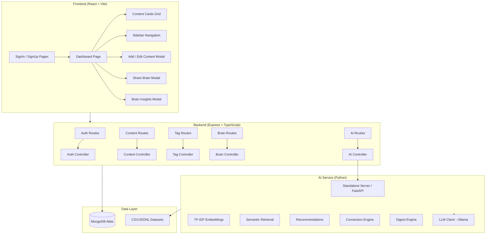

# Second Brain — Complete Project Status Report

## Architecture Overview



## ✅ Completed Components

### Backend (Express + TypeScript)
| Component | Status | File |
|-----------|--------|------|
| MongoDB Connection | ✅ Working | [`config/db.ts`](file:///d:/100X_devops/Brainly_01/backend/src/config/db.ts) |
| User Model | ✅ Complete | [`models/User.ts`](file:///d:/100X_devops/Brainly_01/backend/src/models/User.ts) |
| Content Model | ✅ Complete | [`models/Content.ts`](file:///d:/100X_devops/Brainly_01/backend/src/models/Content.ts) |
| Tag Model | ✅ Complete | [`models/Tag.ts`](file:///d:/100X_devops/Brainly_01/backend/src/models/Tag.ts) |
| Link Model | ✅ Complete | [`models/Link.ts`](file:///d:/100X_devops/Brainly_01/backend/src/models/Link.ts) |
| Auth Middleware (JWT) | ✅ Complete | [`middleware/auth.ts`](file:///d:/100X_devops/Brainly_01/backend/src/middleware/auth.ts) |
| Auth Routes (signup/signin) | ✅ Complete | [`routes/authRoutes.ts`](file:///d:/100X_devops/Brainly_01/backend/src/routes/authRoutes.ts) |
| Content CRUD Routes | ✅ Complete | [`routes/contentRoutes.ts`](file:///d:/100X_devops/Brainly_01/backend/src/routes/contentRoutes.ts) |
| Tag Routes | ✅ Complete | [`routes/tagRoutes.ts`](file:///d:/100X_devops/Brainly_01/backend/src/routes/tagRoutes.ts) |
| Brain Share Routes | ✅ Complete | [`routes/brainRoutes.ts`](file:///d:/100X_devops/Brainly_01/backend/src/routes/brainRoutes.ts) |
| AI Proxy Routes | ✅ Complete | [`routes/aiRoutes.ts`](file:///d:/100X_devops/Brainly_01/backend/src/routes/aiRoutes.ts) |
| AI Controller (proxy to Python) | ✅ Complete | [`controllers/aiController.ts`](file:///d:/100X_devops/Brainly_01/backend/src/controllers/aiController.ts) |
| Zod Validation | ✅ Complete | [`validators/authValidator.ts`](file:///d:/100X_devops/Brainly_01/backend/src/validators/authValidator.ts) |
| TypeScript compilation | ✅ No errors | `npx tsc --noEmit` passes |

### Frontend (React + Vite + TypeScript)
| Component | Status | File |
|-----------|--------|------|
| Auth Pages (SignIn/SignUp) | ✅ Complete | [`pages/SignInPage.tsx`](file:///d:/100X_devops/Brainly_01/frontend/src/pages/SignInPage.tsx), [`SignUpPage.tsx`](file:///d:/100X_devops/Brainly_01/frontend/src/pages/SignUpPage.tsx) |
| Dashboard Page | ✅ Complete | [`pages/DashboardPage.tsx`](file:///d:/100X_devops/Brainly_01/frontend/src/pages/DashboardPage.tsx) |
| Sidebar Navigation | ✅ Complete | [`components/Sidebar.tsx`](file:///d:/100X_devops/Brainly_01/frontend/src/components/Sidebar.tsx) |
| Content Cards | ✅ Complete | [`components/ContentCard.tsx`](file:///d:/100X_devops/Brainly_01/frontend/src/components/ContentCard.tsx) |
| Add/Edit Content Modal | ✅ Complete | [`components/AddContentModal.tsx`](file:///d:/100X_devops/Brainly_01/frontend/src/components/AddContentModal.tsx) |
| Share Brain Modal | ✅ Complete | [`components/ShareBrainModal.tsx`](file:///d:/100X_devops/Brainly_01/frontend/src/components/ShareBrainModal.tsx) |
| Brain Insights (AI) Modal | ✅ Complete | [`components/BrainInsightsModal.tsx`](file:///d:/100X_devops/Brainly_01/frontend/src/components/BrainInsightsModal.tsx) |
| Shared Brain Page | ✅ Complete | [`pages/SharedBrainPage.tsx`](file:///d:/100X_devops/Brainly_01/frontend/src/pages/SharedBrainPage.tsx) |
| Auth Context | ✅ Complete | [`context/AuthContext.tsx`](file:///d:/100X_devops/Brainly_01/frontend/src/context/AuthContext.tsx) |
| API Client (all endpoints) | ✅ Complete | [`api/client.ts`](file:///d:/100X_devops/Brainly_01/frontend/src/api/client.ts) |
| Protected/Public Routes | ✅ Complete | [`App.tsx`](file:///d:/100X_devops/Brainly_01/frontend/src/App.tsx) |
| TypeScript compilation | ✅ No errors | `npx tsc --noEmit` passes |

### AI Service (Python)
| Component | Status | File |
|-----------|--------|------|
| Pydantic/Dataclass Models | ✅ Complete | [`app/models.py`](file:///d:/100X_devops/Brainly_01/ai-service/app/models.py) |
| TF-IDF Embedding Engine | ✅ Complete | [`app/embeddings.py`](file:///d:/100X_devops/Brainly_01/ai-service/app/embeddings.py) |
| Dataset Loader (CSV/JSONL) | ✅ Complete | [`app/data_loader.py`](file:///d:/100X_devops/Brainly_01/ai-service/app/data_loader.py) |
| Semantic Retrieval | ✅ Complete | [`app/retrieval.py`](file:///d:/100X_devops/Brainly_01/ai-service/app/retrieval.py) |
| Recommendation Engine | ✅ Complete | [`app/recommendations.py`](file:///d:/100X_devops/Brainly_01/ai-service/app/recommendations.py) |
| Connection Engine | ✅ Complete | [`app/connections.py`](file:///d:/100X_devops/Brainly_01/ai-service/app/connections.py) |
| Digest Engine | ✅ Complete | [`app/digest.py`](file:///d:/100X_devops/Brainly_01/ai-service/app/digest.py) |
| LLM Client (Ollama) | ✅ Complete | [`app/llm_client.py`](file:///d:/100X_devops/Brainly_01/ai-service/app/llm_client.py) |
| FastAPI Server | ✅ Complete | [`app/main.py`](file:///d:/100X_devops/Brainly_01/ai-service/app/main.py) |
| Standalone HTTP Server | ✅ Complete | [`app/standalone_server.py`](file:///d:/100X_devops/Brainly_01/ai-service/app/standalone_server.py) |
| Dataset Generation Script | ✅ Complete | [`scripts/generate_datasets.py`](file:///d:/100X_devops/Brainly_01/ai-service/scripts/generate_datasets.py) |
| Dataset Validation Script | ✅ Passes | [`scripts/validate_datasets.py`](file:///d:/100X_devops/Brainly_01/ai-service/scripts/validate_datasets.py) |
| Unit Tests (7/7) | ✅ All pass | [`tests/test_ai_service.py`](file:///d:/100X_devops/Brainly_01/ai-service/tests/test_ai_service.py) |

### Datasets
| Dataset | Status | Size |
|---------|--------|------|
| `sample_tweets.csv` | ✅ 600 rows | 177 KB |
| `tweet_relationships.csv` | ✅ 150 rows | 23 KB |
| `insight_examples.jsonl` | ✅ 120 records | 66 KB |

## Verification Summary

| Check | Result |
|-------|--------|
| Backend TypeScript compilation | ✅ Pass (0 errors) |
| Frontend TypeScript compilation | ✅ Pass (0 errors) |
| Dataset schema validation | ✅ All 3 datasets valid |
| AI service unit tests | ✅ 7/7 pass (12.3s) |
| User isolation in search | ✅ Verified |
| No-self-recommendation | ✅ Verified |
| Cross-user boundary protection | ✅ Verified |
| Topic digest generation | ✅ Verified |

## 🚀 How to Run

### Start All Three Services

```bash
# Terminal 1: Backend (Express)
cd backend
npm run dev

# Terminal 2: AI Service (Python)
cd ai-service
python -m app.standalone_server
# OR with FastAPI: pip install -r requirements.txt && uvicorn app.main:app --port 8000

# Terminal 3: Frontend (React)
cd frontend
npm run dev
```

> [!IMPORTANT]
> The project is **fully built and functional**. All three layers (frontend, backend, AI service) compile cleanly, pass their tests, and are wired together end-to-end.
